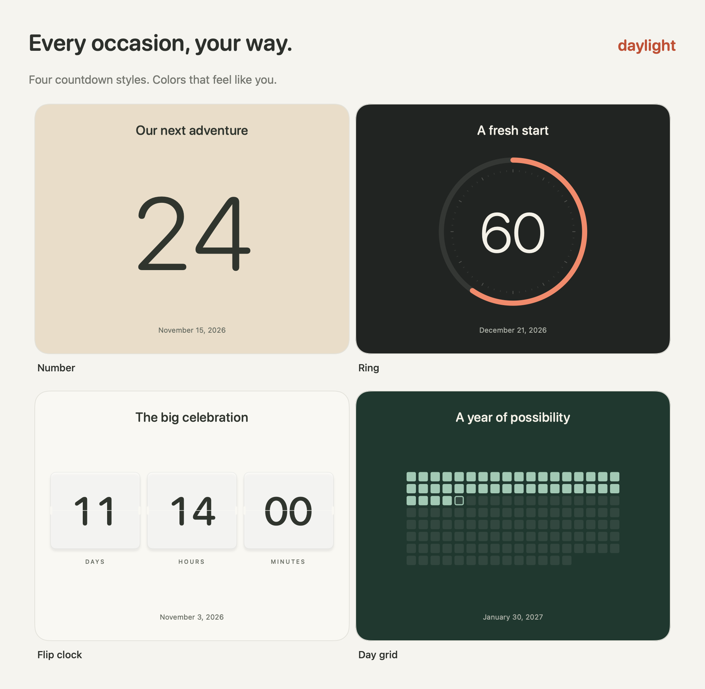

# Daylight

Make room for the days that matter. Beautiful countdowns and focus timers, right on your Mac desktop.

[](https://github.com/jplonghi/Daylight/releases/latest/download/Daylight-macOS-universal.dmg)

**macOS 14 Sonoma or later · Apple silicon & Intel · Free & open source**

[Release notes](https://github.com/jplonghi/Daylight/releases/latest) · [Prefer a ZIP?](https://github.com/jplonghi/Daylight/releases/latest/download/Daylight-macOS-universal.zip)

## Install in three steps

1. **Download and open** `Daylight-macOS-universal.dmg` using the button above.
2. **Drag Daylight into Applications** using the folder shortcut inside the disk image.
3. **Eject the disk image**, then open **Daylight** from Applications.

No account, subscription, or developer tools needed.

### Install with Homebrew

```sh
brew install --cask jplonghi/tap/daylight
```

If Daylight is already in Applications, quit it and remove only the old `Daylight.app` before installing with Homebrew. Your saved countdowns remain in place. [Homebrew tap and uninstall instructions](https://github.com/jplonghi/homebrew-tap)

### First time opening Daylight?

Daylight is not yet notarized by Apple, so macOS may block its first launch. If you trust this download, try opening Daylight from Applications, then go to **System Settings → Privacy & Security → Open Anyway** and confirm. [See Apple's illustrated instructions](https://support.apple.com/en-us/102445).

## Your next occasion, at a glance

Add a trip, a birthday, a new chapter, or a date that is just for you. Choose a style and color palette, then put the countdown where you want it.


## Four ways to watch the days go by

Keep it simple with **Number**, see your progress with **Ring**, count down with **Flip clock**, or watch **Day grid** fill in one day at a time. Each occasion can have its own style, colors, and size.



*Rendered from Daylight's actual countdown views with example occasions.*

## Make yourself at home

- **Focus for a while.** Start a timer and hear a gentle repeating chime when it finishes.
- **Arrange your desktop.** Drag, resize, hide, or keep a countdown above other windows.
- **Pick up where you left off.** Your occasions and window positions are saved; launch at login is optional.
- **Keep it personal.** Your data stays on your Mac. No accounts, tracking, or network requests from the app.

Daylight uses its own desktop windows, so you open it from Applications rather than macOS's Edit Widgets gallery.

[Explore the user guide →](docs/user-guide.md)

## Updating Daylight

Quit Daylight, download the latest DMG using the button above, and drag the new app into Applications. Choose **Replace** when asked. Your saved countdowns remain in place.

If you installed with Homebrew, quit Daylight and run:

```sh
brew update
brew upgrade --cask jplonghi/tap/daylight
```

The Homebrew tap checks for new stable releases every six hours; updates can appear later than the direct download. Daylight does not update itself automatically.

## For developers

Built with SwiftUI and AppKit, with no external packages. Use Xcode 26.6+ (Swift 6.3+) on a macOS version supported by Xcode; the app targets macOS 14+.

```sh
./scripts/test.sh
./scripts/build.sh
open build/Daylight.app
```

Open `Package.swift` in Xcode to develop the app. `./scripts/package-release.sh` creates the universal DMG, ZIP, and checksums in `dist/`.

[Contributing](CONTRIBUTING.md) · [Build and release guide](docs/releasing.md) · [Design notes](docs/design.md)

Source lives in `Sources/`, tests in `Tests/`, and app assets in `Resources/`. Generated builds and local QA captures are ignored by Git; downloadable apps live in GitHub Releases.

## License

[MIT](LICENSE) © 2026 Jose Longhi.
