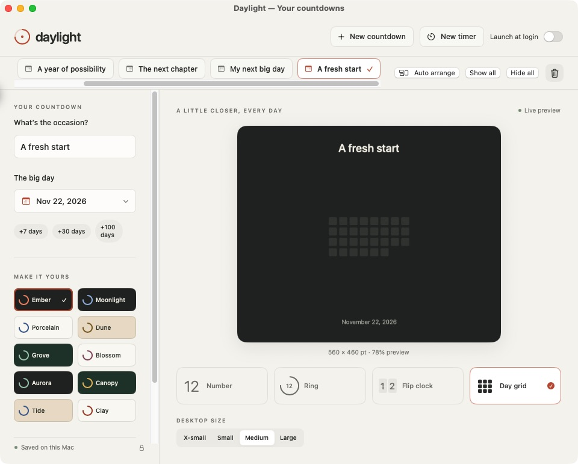

# Daylight

Countdowns and focus timers that live on your Mac desktop.

Choose Number, Ring, Flip clock, or Day grid; give each occasion its own colors and size; and pick up where you left off after restarting. Built with SwiftUI and AppKit, with no external packages, accounts, tracking, or network requests.

## Download and install

**[Download the latest Mac app](https://github.com/jplonghi/Daylight/releases/latest/download/Daylight-macOS-universal.zip)** · [Release notes](https://github.com/jplonghi/Daylight/releases/latest)

Requires **macOS 14 Sonoma or later**. The release ZIP supports **Apple silicon and Intel Macs**. No Xcode or developer tools are needed to use the downloaded app.

1. Download `Daylight-macOS-universal.zip` and double-click it to unzip.
2. Move **Daylight.app** to **Applications**.
3. Open Daylight and create a countdown or focus timer.

The initial release workflow uses an ad-hoc signature and does **not** notarize the app. If macOS blocks it as an unidentified developer, and you trust the release, attempt to open it, then use **System Settings → Privacy & Security → Open Anyway**. See [Apple's instructions](https://support.apple.com/en-us/102445). There is no need to disable Gatekeeper globally.

To update, quit Daylight, download the latest ZIP, and replace the app in Applications. Your countdowns are stored separately and remain in place. Updates are manual; the app does not check for updates in the background.

> Downloads become available after the first release is published. See the [publishing guide](docs/releasing.md).



## What it does

- Independent desktop countdowns with four styles, ten color presets, and four sizes.
- Focus timers with a repeating chime and acknowledgment.
- Drag, resize, hide, pin above other windows, or arrange widgets by deadline.
- Menu-bar controls, optional launch at login, and saved window positions.
- Local data, accessible summaries, keyboard shortcuts, and Reduce Motion support.

Daylight uses desktop windows; it is not a widget in macOS's Edit Widgets gallery.

Read the [user guide](docs/user-guide.md) for controls, shortcuts, timer behavior, and data recovery.

## Build from source

Requires macOS 14+ and Xcode 16+ with Swift 6 or newer. Select the Xcode command-line tools in Xcode settings before building.

```sh
./scripts/test.sh
./scripts/build.sh
open build/Daylight.app
```

Open `Package.swift` in Xcode to work on the app. To create the same universal ZIP used for GitHub Releases:

```sh
./scripts/package-release.sh
```

The ZIP and SHA-256 checksum are written to `dist/`. The release app is built separately in `build/release/Daylight.app`.

## Repository layout

```text
.github/workflows/    Automated tests and release packaging
Sources/Daylight/     SwiftUI views and macOS integration
Sources/DaylightCore/ Countdown, timer, persistence, and layout logic
Tests/               Core behavior tests
Resources/           App metadata and original timer chime
scripts/             Build, test, icon, and release tools
docs/                User, contributor, design, and publishing guides
Package.swift        Swift package definition
```

`.build/`, `build/`, `dist/`, and `docs/evidence/` stay local and are ignored by Git. Compiled apps belong in **GitHub Release assets**, not in the source repository.

## Contributing

See [CONTRIBUTING.md](CONTRIBUTING.md). Please include your macOS version and reproduction steps when reporting a bug; remove personal countdowns and local paths from screenshots and logs.

## License

[MIT](LICENSE) © 2026 Jose Longhi.
